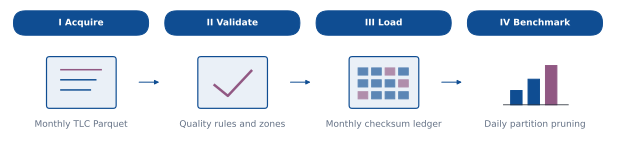
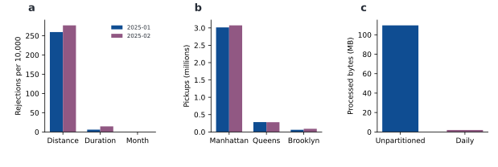

# NYC Taxi Data Quality and Incremental Warehouse


A SQL-first warehouse that audits monthly NYC yellow taxi exports, loads each batch once, and links accepted trips to the official taxi zone lookup. The reference run covers January and February 2025.


The vector figures are available as PDF in [figures/](figures/). With Python, NumPy and Matplotlib installed, run `python paper_figures.py` to regenerate them. The visual conventions follow [figures4papers](https://github.com/ChenLiu-1996/figures4papers).

[Run locally](#run-locally) · [Data contract](#data-contract) · [Evidence](evidence/) · [BigQuery benchmark](bigquery/)

## What the data showed

The pipeline read **7,052,769** source rows and accepted **6,856,171**. It rejected **196,598** under the documented rules. Invalid distance was the largest rejection category in both months. Manhattan accounted for **88.8%** of accepted pickups across the two months.



Panel a reports rejection rates. Panel b shows accepted pickups in the three leading boroughs. Panel c compares measured BigQuery bytes for the same query.


## Run locally

From the repository root, with Python 3.11 or later:

```bash
python -m pip install -r requirements.txt
python warehouse.py 2025-01
python warehouse.py 2025-01 2025-02
python warehouse.py
python -m unittest discover -s tests -v
```

The first run loads January. The second skips January and appends February. The third skips both. The CLI downloads the source files on demand and writes the DuckDB file and aggregate CSVs to `output/`. Raw inputs and the local database are excluded from Git.

Compare the four CSVs in `output/` with [the reference evidence](evidence/). Source SHA-256 hashes are recorded for both monthly files and the zone lookup. To regenerate the checked-in SVGs from the reference CSVs, run `python figures.py`.

## Data contract

- **One accepted record per source row that passes validation.** The source projection has no reliable trip ID. Idempotency is at file-batch level. The warehouse does not deduplicate similarly shaped rides within an upstream file.
- **First failure wins.** Rows are checked for missing timestamps, pickup outside the file month, nonpositive or over-24-hour duration, missing or nonpositive distance, and missing zone keys, in that order. A known lookup row can still be labeled Unknown or N/A.
- **Atomic batch writes.** The accepted records, quality counts and checksum ledger commit together. Identical files are skipped and changes to a previously loaded month or to the lookup require a fresh database.
- **Time semantics.** Source dates are treated as local wall-clock values. The analysis is an audit of the published data under these rules, with no attempt to infer an individual journey from the aggregates.

Source: [NYC Taxi & Limousine Commission Trip Record Data](https://www.nyc.gov/site/tlc/about/tlc-trip-record-data.page), including the original Yellow Taxi Parquet files and Taxi Zone Lookup CSV. The published repository contains derived aggregates, not the source files.

## BigQuery benchmark

Daily partitioning reduced the bytes processed by the one-day query by **98.22%**, from **109,698,736 bytes** on the unpartitioned table to **1,950,416 bytes** on the partitioned table. Both BigQuery queries ran with caching disabled and returned **121,901 trips** and a mean distance of **6.4761 miles**, matching DuckDB.

The sandbox run applied the same date offset to both tables to keep historical partitions within the sandbox retention window. The one-day grouping and trip values were preserved. [Run evidence and job IDs](evidence/bigquery-benchmark.json) · [Reproduce the benchmark](bigquery/README.md)
